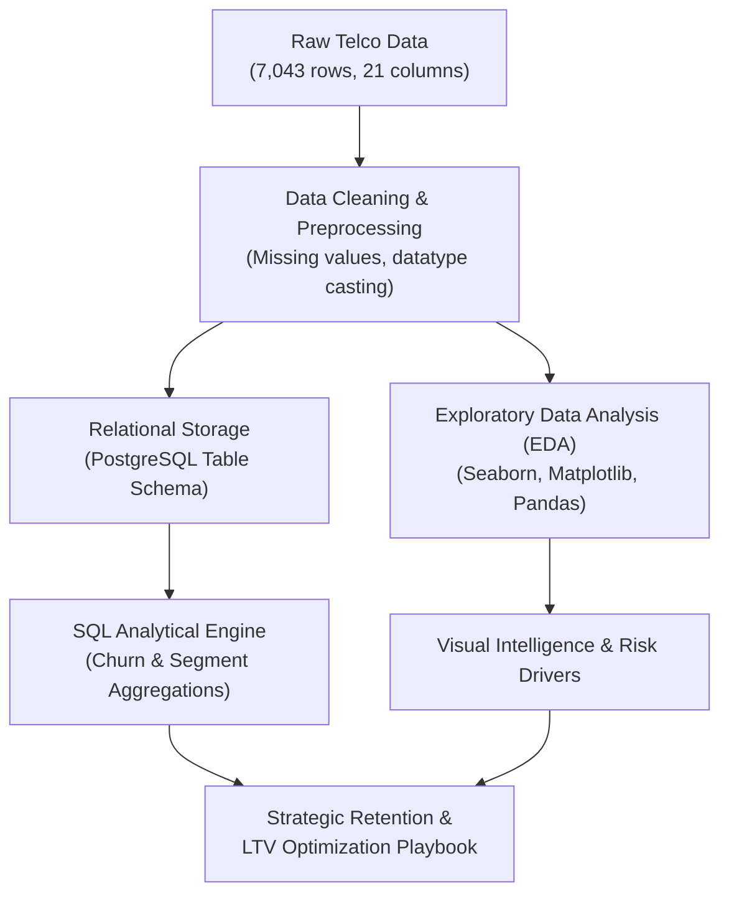
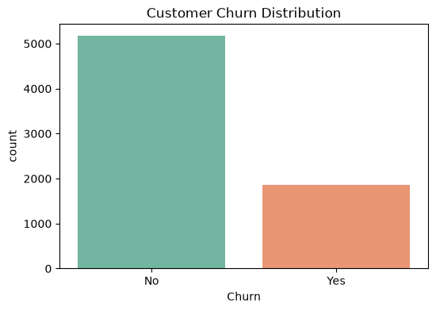
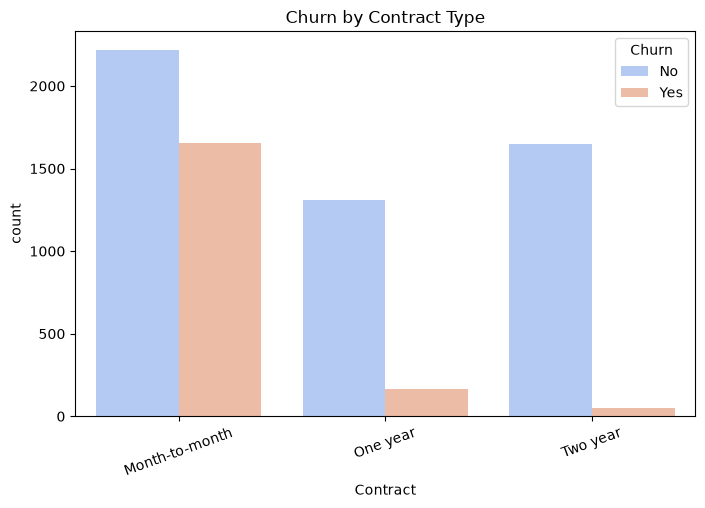
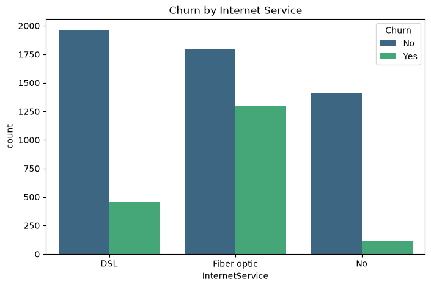

# 📊 Customer Churn & Lifetime Value (LTV) Engine

[](https://www.python.org/)
[](https://www.postgresql.org/)
[](https://pandas.pydata.org/)
[](https://seaborn.pydata.org/)
[](https://www.linkedin.com/in/adarsh-pandey-539208293)
[](https://opensource.org/licenses/MIT)

> An end-to-end data analytics and predictive engine designed to analyze telecom customer attrition, uncover key churn drivers, integrate enterprise SQL databases, and model customer retention strategies to maximize Customer Lifetime Value (LTV).

---

## 📌 Executive Summary

Customer acquisition costs in telecom are **5x higher** than retention costs. Uncontrolled churn directly erodes top-line revenue, diminishes customer lifetime value, and shrinks profit margins.

This project delivers a full data analytics lifecycle—from raw data ingestion, auditing, and cleaning to PostgreSQL relational storage, automated SQL queries, comprehensive exploratory data analysis (EDA), and business intelligence insights.

### 🎯 Key Performance Indicators (KPIs)
| Metric | Value | Business Significance |
| :--- | :--- | :--- |
| **Total Customer Base** | **7,043** | Full dataset audited and preprocessed |
| **Retained Customers** | **5,174 (73.46%)** | Established baseline subscriber pool |
| **Churned Customers** | **1,869 (26.54%)** | Target population for retention interventions |
| **Month-to-Month Churn Rate** | **42.7%** | Highest risk contract type (vs 2.8% on 2-year plans) |
| **Electronic Check Churn** | **45.3%** | Most vulnerable payment method |
| **Fiber Optic Churn** | **41.9%** | Critical service category requiring onboarding review |

---

## 🏗️ Architecture & Data Pipeline



---

## 🔍 Exploratory Data Analysis & Visual Insights

### 1. Overall Churn Distribution
The baseline churn rate across the 7,043 analyzed subscribers stands at **26.54%** (~1,869 accounts), establishing a high-priority business challenge.



---

### 2. Contract Type vs. Churn Risk
Contract commitment is the single strongest predictor of customer stability:
- **Month-to-Month**: **42.7% Churn Rate** — Customers lack switching barriers and churn rapidly.
- **One-Year Contract**: **11.3% Churn Rate** — Substantial churn reduction (~73% lower risk).
- **Two-Year Contract**: **2.8% Churn Rate** — Maximum customer retention and revenue stability.



---

### 3. Customer Tenure & Drop-off Horizon
Attrition is heavily concentrated in the early lifecycle stages:
- **First 12 Months**: Peak churn velocity occurs during initial onboarding.
- **After 24 Months**: Attrition drops dramatically; customers entering their second year display strong platform loyalty.


---

### 4. Monthly Charges Impact
- Customers paying **over $70/month** display significantly elevated churn frequency.
- High monthly charges without perceived value-add or active tech support trigger price-sensitivity attrition.


---

### 5. Service Type & Payment Method Drivers
- **Internet Service**: **Fiber Optic** subscribers exhibit an alarming **41.9% churn rate**, in stark contrast to **DSL (19.0%)** and No Internet (7.4%). This suggests customer dissatisfaction with fiber pricing or installation reliability.
- **Payment Method**: **Electronic Check** users show a **45.3% churn rate**, whereas automated credit card and bank transfer subscribers show churn rates under 18%.



---

## 📑 Excel Data Exploration & Pivot Modeling

The exploratory analysis commenced with manual hygiene audits and pivot modeling in **Microsoft Excel** ([`excel/Telco_Customer_Churn_Exploration.xlsx`](excel/Telco_Customer_Churn_Exploration.xlsx)):

1. **Hygiene & Data Auditing**:
   - Resolved 11 whitespace records in `TotalCharges` (customers with `tenure = 0`), casting the column from text to numeric currency.
2. **Pivot Table 1 (Contract Vulnerability)**:
   - Evaluated churn volume by contract: Month-to-month contracts drive **88.5% of all attrition** (42.71% churn rate) compared to 2.83% for 2-year plans.
3. **Pivot Table 2 (Tenure Risk Cohorts)**:
   - Bucketed tenure into 6 cohorts: **55.48% of all churners** drop out within the **0–12 month window** (47.44% cohort churn rate).
4. **Outlier Detection via Conditional Formatting**:
   - Highlighted accounts paying $\ge \$70/\text{month}$ (top quartiles) where price sensitivity significantly accelerates churn.

---

## 🗄️ Relational Database (PostgreSQL) Integration

The analytical pipeline is backed by a structured relational schema in PostgreSQL for enterprise queries:

```sql
-- Churn Breakdown Query
SELECT Churn, COUNT(*) AS customer_count,
       ROUND(COUNT(*) * 100.0 / SUM(COUNT(*)) OVER(), 2) AS churn_percentage
FROM customers 
GROUP BY Churn;

-- Contract Breakdown Query
SELECT Contract, COUNT(*) AS total_customers,
       SUM(CASE WHEN Churn = 'Yes' THEN 1 ELSE 0 END) AS churned_count,
       ROUND(SUM(CASE WHEN Churn = 'Yes' THEN 1 ELSE 0 END) * 100.0 / COUNT(*), 2) AS churn_rate_pct
FROM customers 
GROUP BY Contract
ORDER BY churn_rate_pct DESC;
```

---

## 📂 Project Directory Structure

```plaintext
Customer-Churn-LTV-Engine/
├── dashboard/                  # Interactive BI dashboards & presentation decks
├── data/
│   ├── data_dictionary.md      # Field descriptions, data types, and domains
│   ├── telco_customer_churn_clean.csv  # Preprocessed production dataset
│   └── WA_Fn-UseC_-Telco-Customer-Churn.csv # Raw baseline dataset
├── excel/
│   └── Telco_Customer_Churn_Exploration.xlsx # Multi-sheet Excel workbook with pivots & formatting
├── notebooks/
│   ├── 01_data_cleaning.ipynb  # Missing value handling, typing & deduplication
│   ├── 02_database_import.ipynb# PostgreSQL pipeline & connection scripts
│   ├── 03_exploratory_data_analysis.ipynb # Complete EDA, statistical tests & plots
│   └── reports/
│       ├── business_insights.md# Executive takeaways & analytical summary
│       └── excel_data_exploration.md # Detailed Excel data exploration report
├── sql/
│   ├── 01_create_database.sql  # Database initialization
│   ├── 02_create_table.sql     # Table schema definition
│   └── 03_basic_analysis.sql   # Key aggregation & segmentation queries
├── src/
│   ├── churn_analysis.py       # Core churn metrics calculator
│   ├── excel_data_exploration.py # Automated generator for corporate Excel workbook
│   └── preprocess.py           # Reusable data transformation pipelines
├── visuals/                    # Generated visual analytics charts
├── .gitignore                  # Git exclusion rules
├── requirements.txt            # Python dependencies
└── README.md                   # Project documentation
```

---

## 💡 Strategic Business Recommendations

Based on empirical data findings, the following high-ROI interventions are recommended:

1. **Incentivize Long-Term Contract Migration**:
   - Provide discounted device upgrades or monthly rebates ($5–$10/mo) for migrating from Month-to-Month to 1-Year or 2-Year contracts.
2. **Revamp Fiber Optic Onboarding (First 90 Days)**:
   - Introduce proactive check-ins and free premium technical support during months 1–3 to reduce early drop-offs.
3. **Drive Automated Payment Adoption**:
   - Offer a one-time bill credit ($15) for switching from Electronic Check to Auto-Pay (Bank Transfer / Credit Card).
4. **Targeted At-Risk Retention Playbook**:
   - Deploy automated alerts when a Month-to-Month subscriber paying >$70/mo reaches month 3 without tech support enrollment.

---

## ⚡ Setup & Execution

### 1. Clone the Repository
```bash
git clone https://github.com/addu91577-sketch/Customer-Churn-LTV-Engine.git
cd Customer-Churn-LTV-Engine
```

### 2. Environment Setup
```bash
python -m venv venv
# Windows
.\venv\Scripts\activate
# Mac/Linux
source venv/bin/activate
```

### 3. Install Dependencies
```bash
pip install -r requirements.txt
```

### 4. Run Analysis Script
```bash
python src/churn_analysis.py
```

---

## 👤 Author & Contributor

**Adarsh Kumar Pandey**  
*Data Analyst*

- **LinkedIn**: [linkedin.com/in/adarsh-pandey-539208293](https://www.linkedin.com/in/adarsh-pandey-539208293)
- **GitHub**: [@addu91577-sketch](https://github.com/addu91577-sketch)
- **Email**: [addu91577@gmail.com](mailto:addu91577@gmail.com)

---

## 📄 License
This project is open-source under the [MIT License](LICENSE).
