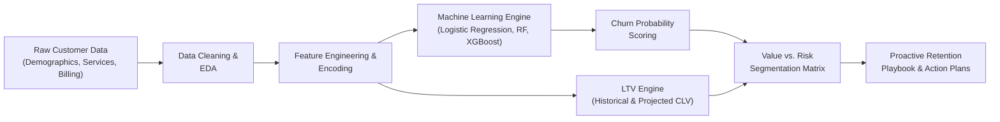

# 📊 Customer Churn Prediction & Lifetime Value (LTV) Engine

[](https://www.python.org/)
[](https://pandas.pydata.org/)
[](https://scikit-learn.org/)
[](https://xgboost.readthedocs.io/)
[](https://www.linkedin.com/in/adarsh-pandey-539208293)
[](https://opensource.org/licenses/MIT)

> An end-to-end data analytics and predictive machine learning engine designed to detect customer churn patterns, quantify Customer Lifetime Value (LTV), and deliver actionable retention strategies for telecommunications and subscription-based businesses.

---

## 📌 Executive Summary

Acquiring new customers costs significantly more than retaining existing ones. In the telecommunications sector, customer churn directly impacts top-line revenue, operational margins, and long-term brand equity.

This repository implements a **Customer Churn & LTV Optimization Engine** that shifts business strategy from **reactive damage control** to **proactive, high-ROI customer retention**. By coupling probabilistic churn classification models with granular Customer Lifetime Value estimations, this engine enables business stakeholders to prioritize retention budgets on customers who generate the highest enterprise value.

---

## 🏗️ Architecture & Pipeline



---

## 🚀 Key Capabilities

- **Multi-Model Churn Classification**: Benchmarking Logistic Regression, Random Forest, and XGBoost with hyperparameter tuning to accurately isolate churn risk factors.
- **Customer Lifetime Value (LTV) Calculation**: Quantifies the monetary contribution of each customer based on monthly billing charges, tenure duration, and projected contract renewal rates.
- **2x2 Risk-Value Decision Matrix**:
  - **High Value, High Risk (Top Priority)**: High-touch account management, tailored renewal discounts, proactive customer support.
  - **High Value, Low Risk (Brand Advocates)**: Loyalty rewards, cross-sell and up-sell opportunities (e.g., fiber optic upgrades, streaming packages).
  - **Low Value, High Risk (Cost-Sensitive)**: Automated re-engagement workflows, self-service incentive offers.
  - **Low Value, Low Risk (Stable Base)**: Standard marketing newsletters, baseline monitoring.
- **Feature Importance & Driver Attribution**: Uncovers the key drivers of attrition, including contract duration (Month-to-Month vs. Two-Year), payment methods (Electronic Check vs. Auto-pay), and tech support enrollment.

---

## 🛠️ Tech Stack & Tools

- **Programming Language**: Python
- **Data Manipulation & Analysis**: Pandas, NumPy
- **Machine Learning**: Scikit-Learn, XGBoost
- **Statistical Visualization**: Matplotlib, Seaborn
- **Business Intelligence & Reporting**: Microsoft Excel, Jupyter Notebooks

---

## 📂 Project Structure

```plaintext
Telco _Customer_Churn/
├── Data/                 # Raw and preprocessed customer datasets
├── Excel/                # Cohort analysis sheets, financial impact models, and KPI dashboards
├── notebooks/            # Jupyter notebooks for EDA, feature selection, and model training
├── src/                  # Modular Python scripts for data pipeline, modeling, and evaluation
├── .gitignore            # Git exclusion rules for clean version control
├── requirements.txt      # Python dependencies
└── README.md             # Project documentation and business overview
```

---

## 📈 Evaluation Metrics & Business Objective

Predicting churn demands a business-aligned evaluation strategy:
- **Recall (Sensitivity)**: Prioritized to minimize False Negatives (identifying as many churners as possible before they leave).
- **ROC-AUC Score**: Evaluates discriminative ability across multiple decision thresholds.
- **Precision & F1-Score**: Balances campaign cost efficiency against false-alarm retention incentives.

---

## ⚡ Quickstart & Installation

### 1. Clone the Repository
```bash
git clone https://github.com/addu91577-sketch/Customer-Churn-Prediction-Life-Time-Value-Engine.git
cd Customer-Churn-Prediction-Life-Time-Value-Engine
```

### 2. Create & Activate a Virtual Environment
```bash
# Windows
python -m venv venv
.\venv\Scripts\activate
```

### 3. Install Dependencies
```bash
pip install -r requirements.txt
```

---

## 👤 Author & Contact

**Adarsh Kumar Pandey**  
*Data Analyst*

- **LinkedIn**: [linkedin.com/in/adarsh-pandey-539208293](https://www.linkedin.com/in/adarsh-pandey-539208293)
- **GitHub**: [@addu91577-sketch](https://github.com/addu91577-sketch)
- **Email**: [addu91577@gmail.com](mailto:addu91577@gmail.com)

---

## 📄 License
This project is licensed under the [MIT License](LICENSE).
